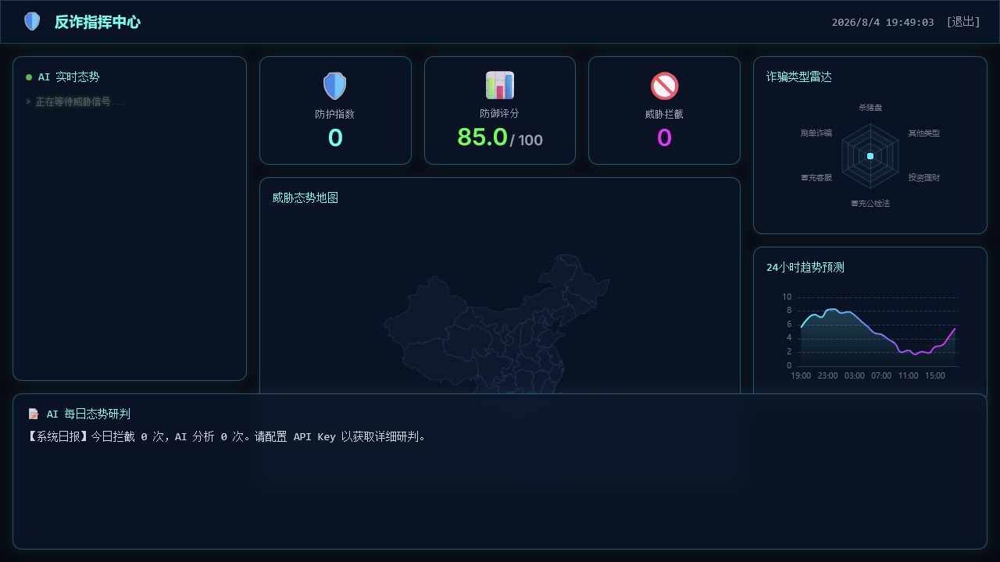
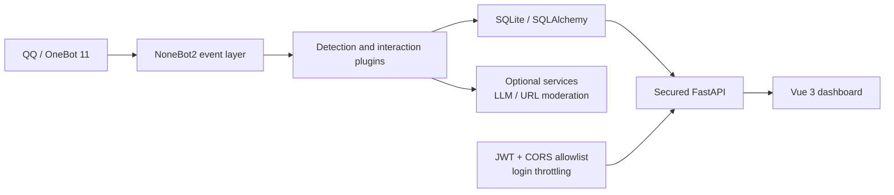

<p align="center">
  
</p>

<h1 align="center">AntiFraudBot</h1>

<p align="center">
  <strong>An intelligent anti-fraud bot and security dashboard for QQ groups</strong><br />
  <span>Connect risk detection, education, quizzes, AI analysis, and visual reporting in one deployable and extensible project.</span>
</p>

<p align="center">
  <a href="README.md">简体中文</a>
  ·
  <a href="README.en.md"><strong>English</strong></a>
  ·
  <a href="docs/en/README.md">Documentation</a>
  ·
  <a href="SECURITY.md">Security</a>
  ·
  <a href="CONTRIBUTING.md">Contributing</a>
</p>

<p align="center">
  <a href="LICENSE"></a>
  
  
  
  
  
</p>



## Table of contents

- [Why it exists](#why-it-exists)
- [Feature map](#feature-map)
- [Bundled content](#bundled-content)
- [Architecture](#architecture)
- [Five-minute setup](#five-minute-setup)
- [Common commands](#common-commands)
- [Security model](#security-model)
- [Development checks](#development-checks)
- [Contributing](#contributing)
- [Roadmap](#roadmap)
- [License and responsible use](#license-and-responsible-use)

## Why it exists

Fraud risk in a group chat is rarely a single signal. Suspicious keywords, disguised links, manipulative language, and gaps in fraud awareness often appear together. A one-off warning cannot cover continuous education, interactive learning, event records, and later review.

AntiFraudBot connects these needs in one extensible system: the bot detects and interacts inside group chats, the database keeps structured records, and secured APIs feed masked trends and risk information to the web command center. External AI and URL moderation remain optional, so missing service credentials never block the core local capabilities.

> 🛡️ The goal is not to replace law enforcement, banks, or platform risk controls. It is to make risk alerts, anti-fraud education, and situational awareness more timely, continuous, and deployable.

It is designed for:

- 🏫 anti-fraud education in schools and community settings;
- 👥 keyword and suspicious-link assistance in QQ group chats;
- 🧠 quizzes, daily check-ins, scores, and leaderboards;
- 🤖 fraud-language analysis through OpenAI-compatible APIs;
- 📊 operational dashboards for trends, risk categories, and activity;
- 🧩 learning a complete NoneBot2, FastAPI, SQLAlchemy, and Vue integration.

> [!IMPORTANT]
> AntiFraudBot is an assistive tool. It does not replace law enforcement, banks, platform risk controls, or professional legal advice. Stop and verify through an official channel whenever money, verification codes, credentials, or account control are involved.

## Feature map

| Module | Capability | Status |
|---|---|---|
| 🔍 Keyword detection | Reads active database entries, records matches, and warns users | ✅ Implemented |
| 🔗 URL risk checks | Optional Alibaba Cloud URL moderation integration | ✅ Implemented; credentials optional |
| 📚 Educational pushes | Scheduled anti-fraud images and case messages | ✅ Implemented |
| 🧠 AI fraud analysis | Analyzes suspicious text through an OpenAI-compatible API | ✅ Implemented; external service optional |
| 💬 Conversational assistant | Multi-turn context, lightweight retrieval, and group statistics | 🟡 Usable; image OCR is not implemented |
| 🏆 Quiz and scores | Daily check-ins, quizzes, score tracking, and leaderboards | ✅ Implemented |
| 🖥️ Web dashboard | JWT login, metrics, trends, radar, reports, and virtual map | ✅ Implemented |
| 🛠️ Management API | Keyword and quiz query/create/update/deactivate operations | ✅ Implemented; full management UI pending |
| 📈 Forecast curve | Deterministic heuristic visualization | 🟡 Display aid, not a trained prediction model |

## Bundled content

- 🖼️ 53 anti-fraud knowledge images;
- 📰 53 case-study text files;
- 🔑 588 deduplicated keyword entries;
- ❓ 126 quiz questions.

Read [NOTICE.md](NOTICE.md) before redistributing bundled content. Deployers remain responsible for reviewing content against applicable law, platform rules, and local requirements.

## Architecture



```text
AntiFraudBot/
├── src/
│   ├── database/                 # SQLAlchemy models and data access
│   ├── plugins/                  # NoneBot detection, AI, push, and quiz plugins
│   └── web/
│       ├── api/                  # FastAPI authentication and business APIs
│       └── frontend_v2/          # Vue 3 + Vite dashboard
├── source/                       # Quiz, keywords, cases, and educational images
├── scripts/                      # Initialization and repository checks
├── tests/                        # Security and consistency regressions
├── docs/                         # Chinese and English documentation
├── .env.example                  # NoneBot environment selector template
└── .env.prod.example             # Complete production configuration template
```

## Five-minute setup

### Requirements

- Python `3.9–3.12`;
- Poetry `2.x`;
- Node.js `22+`;
- a OneBot 11 implementation such as [NapCat](https://napneko.github.io/);
- Git.

### Install

```bash
git clone https://github.com/itsevin/AntiFraudBot.git
cd AntiFraudBot
poetry install
```

Create local configuration files:

```bash
cp .env.example .env
cp .env.prod.example .env.prod
```

PowerShell users can run:

```powershell
Copy-Item .env.example .env
Copy-Item .env.prod.example .env.prod
```

Set at least a strong dashboard password in `.env.prod`:

```dotenv
WEB_ADMIN_PASSWORD=CHANGE_ME_USE_AT_LEAST_12_CHARACTERS
```

The template pins the ORM database to `data/data.db`; keep `SQLALCHEMY_DATABASE_URL` configured.

> [!CAUTION]
> `.env`, `.env.prod`, databases, and generated JWT secrets are ignored by Git. Never force-add them.

Initialize data and build the dashboard:

```bash
poetry run python scripts/init_database.py

cd src/web/frontend_v2
npm ci
npm run build
cd ../../..
```

Start the bot:

```bash
poetry run nb run
```

Default endpoints:

| Service | URL |
|---|---|
| NoneBot / OneBot service | `http://127.0.0.1:8080` |
| Dashboard login | `http://127.0.0.1:8000/#/login` |

The dashboard listens on loopback by default. Put it behind an HTTPS reverse proxy and configure `WEB_CORS_ORIGINS` explicitly for public deployments.

See the complete [Installation Guide](docs/en/installation.md).

## Common commands

The effective prefix depends on `COMMAND_START`. With the default configuration:

| Command | Purpose |
|---|---|
| `帮助` | Show the bot menu |
| `鉴诈 suspicious text` | Analyze suspicious language with the configured AI service |
| `反诈咨询 question` | Ask the conversational anti-fraud assistant |
| `签到` | Daily check-in and points |
| `反诈答题` | Start the daily quiz |
| `我的积分` | Show personal score statistics |
| `积分排行` | Show the current group leaderboard |
| `开启 关键词检测` | Enable a feature as a group administrator |
| `关闭 关键词检测` | Disable a feature as a group administrator |

See the [User Guide](docs/en/user-guide.md) for permissions and detailed behavior.

## Security model

- Every dashboard business API requires a valid JWT; login is the only anonymous API.
- Missing, short, or common default administrator passwords fail closed.
- Failed login attempts are throttled by source address.
- CORS uses an explicit allowlist and rejects wildcards.
- User and group identifiers returned by dashboard APIs are masked.
- A random JWT secret is stored in ignored `data/.jwt_secret` when none is configured.
- CI runs tests, critical lint checks, public-repository checks, and full-history secret scanning.

Do not disclose vulnerabilities in public issues. Follow [SECURITY.md](SECURITY.md) and use GitHub Private Vulnerability Reporting.

## Development checks

```bash
poetry run pytest -q
poetry run ruff check src scripts tests
poetry run python scripts/check_open_source.py

cd src/web/frontend_v2
npm ci
npm run build
```

Read the [Developer Guide](docs/en/development.md) for architecture, APIs, and plugin conventions.

## Contributing

Bug fixes, educational content, documentation, adapters, and security improvements are welcome. Before opening a pull request:

1. read [CONTRIBUTING.md](CONTRIBUTING.md);
2. remove real QQ IDs, chat records, databases, tokens, and API keys;
3. add tests and bilingual documentation for behavior changes;
4. report the exact verification commands and results.

## Roadmap

- [ ] complete keyword and quiz management UI;
- [ ] pluggable OCR and vector retrieval;
- [ ] versioned database migrations;
- [ ] multiple administrators and fine-grained roles;
- [ ] reproducible detection evaluation datasets;
- [ ] container deployment after end-to-end validation.

## License and responsible use

Project code is licensed under the [MIT License](LICENSE). Bundled content and third-party service considerations are described in [NOTICE.md](NOTICE.md).

Use AntiFraudBot only for lawful anti-fraud education, community protection, and security research. You are responsible for complying with platform policies, service terms, privacy requirements, and applicable law.

---

⭐ If AntiFraudBot is useful to you, consider leaving a Star and contributing practical, verifiable improvements through issues and pull requests.
