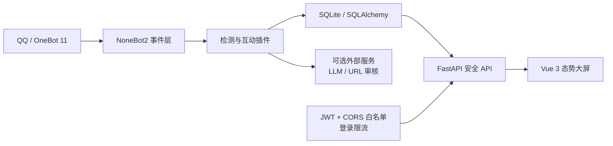

<p align="center">
  
</p>

<h1 align="center">AntiFraudBot</h1>

<p align="center">
  <strong>面向 QQ 群聊的智能反诈机器人与安全态势平台</strong><br />
  <span>把风险检测、知识传播、互动答题、AI 分析与可视化研判连接成一套可部署、可扩展的反诈工具。</span>
</p>

<p align="center">
  <a href="README.md"><strong>简体中文</strong></a>
  ·
  <a href="README.en.md">English</a>
  ·
  <a href="docs/README.md">文档中心</a>
  ·
  <a href="SECURITY.md">安全策略</a>
  ·
  <a href="CONTRIBUTING.md">参与贡献</a>
</p>

<p align="center">
  <a href="LICENSE"></a>
  
  
  
  
  
</p>


## 目录

- [为什么需要它](#为什么需要它)
- [功能全景](#功能全景)
- [内容资源](#内容资源)
- [系统架构](#系统架构)
- [五分钟开始](#五分钟开始)
- [常用指令](#常用指令)
- [安全设计](#安全设计)
- [开发与验证](#开发与验证)
- [参与贡献](#参与贡献)
- [后续方向](#后续方向)
- [许可证与声明](#许可证与声明)

## 为什么需要它

群聊里的诈骗风险通常不是一道单选题：可疑关键词、伪装链接、诱导话术和反诈知识缺口往往同时出现。只做一次关键词提醒，难以覆盖持续宣传、互动学习、事件留痕和后续研判。

AntiFraudBot 将这些环节放进同一套可扩展系统：机器人负责在群聊中检测和互动，数据库保留结构化记录，安全 API 向 Web 指挥中心提供脱敏后的趋势与风险信息；外部 AI 和 URL 审核服务则保持可选，不配置密钥也不会阻塞基础能力。

> 🛡️ 项目的目标不是替代公安机关、银行或平台风控，而是让群聊中的风险提醒、反诈教育和态势观察更及时、更连续、更容易部署。

项目适合用于：

- 🏫 校园与社区场景的反诈宣传；
- 👥 QQ 群聊中的关键词与风险链接辅助检测；
- 🧠 反诈知识问答、签到积分和排行榜互动；
- 🤖 基于兼容 OpenAI API 的大模型进行诈骗话术分析；
- 📊 展示拦截趋势、风险类型与系统运行情况；
- 🧩 学习 NoneBot2 插件、FastAPI、SQLAlchemy 和 Vue 的完整集成。

> [!IMPORTANT]
> AntiFraudBot 是辅助识别工具，不替代公安机关、银行、平台风控或专业法律意见。涉及转账、验证码、账号控制权时，请优先停止操作并通过官方渠道核实。

## 功能全景

| 模块 | 能力 | 状态 |
|---|---|---|
| 🔍 关键词检测 | 从数据库读取启用词条，记录命中日志并提示风险 | ✅ 已实现 |
| 🔗 URL 风险检测 | 可选接入阿里云内容安全 URL 检测 | ✅ 已实现，可选凭据 |
| 📚 知识与案例推送 | 定时向启用的群聊或私聊推送图文与案例 | ✅ 已实现 |
| 🧠 AI 智能鉴诈 | 调用兼容 OpenAI API 的服务分析可疑文本 | ✅ 已实现，可选服务 |
| 💬 智能对话助手 | 多轮上下文、基础知识检索与群组统计辅助 | 🟡 可用；图片 OCR 尚未实现 |
| 🏆 积分答题 | 签到、每日答题、积分统计与群排行榜 | ✅ 已实现 |
| 🖥️ Web 态势大屏 | JWT 登录、风险指标、趋势、雷达、日报和虚拟地图 | ✅ 已实现 |
| 🛠️ 管理 API | 敏感词和题库的查询、添加、更新与停用 | ✅ 已实现；暂未提供完整管理 UI |
| 📈 趋势预测 | 用于大屏展示的确定性启发式曲线 | 🟡 展示功能，不是训练模型预测 |

## 内容资源

当前仓库包含：

- 🖼️ 53 张反诈知识图片；
- 📰 53 份诈骗案例文本；
- 🔑 588 条去重关键词；
- ❓ 126 道反诈问答题。

内容素材的许可边界请阅读 [NOTICE.md](NOTICE.md)。部署者应根据当地法律、平台规则和实际使用场景审核内容。

## 系统架构



核心目录：

```text
AntiFraudBot/
├── src/
│   ├── database/                 # SQLAlchemy 模型与数据访问
│   ├── plugins/                  # NoneBot 检测、推送、AI、答题插件
│   └── web/
│       ├── api/                  # FastAPI 认证与业务 API
│       └── frontend_v2/          # Vue 3 + Vite 态势大屏
├── source/                       # 题库、关键词、案例与知识图片
├── scripts/                      # 初始化、检查和维护脚本
├── tests/                        # 安全与一致性回归测试
├── docs/                         # 中英双语文档
├── .env.example                  # NoneBot 环境选择模板
└── .env.prod.example             # 完整生产配置模板
```

## 五分钟开始

### 1. 准备环境

- Python `3.9–3.12`；
- Poetry `2.x`；
- Node.js `22+`；
- 支持 OneBot 11 的 QQ 机器人实现，例如 [NapCat](https://napneko.github.io/)；
- Git。

### 2. 获取并安装

```bash
git clone https://github.com/itsevin/AntiFraudBot.git
cd AntiFraudBot
poetry install
```

### 3. 创建本地配置

Windows PowerShell：

```powershell
Copy-Item .env.example .env
Copy-Item .env.prod.example .env.prod
```

Linux / macOS：

```bash
cp .env.example .env
cp .env.prod.example .env.prod
```

至少修改 `.env.prod` 中的：

```dotenv
WEB_ADMIN_PASSWORD=CHANGE_ME_USE_AT_LEAST_12_CHARACTERS
```

模板已经把 ORM 数据库固定为 `data/data.db`，请不要删除 `SQLALCHEMY_DATABASE_URL`。

如果不使用 AI 或阿里云 URL 检测，可以保持对应密钥为空，并关闭相关可选能力。

> [!CAUTION]
> `.env`、`.env.prod`、数据库和 JWT 密钥均已被 Git 忽略。不要使用 `git add -f` 强制提交它们。

### 4. 初始化数据库并构建前端

```bash
poetry run python scripts/init_database.py

cd src/web/frontend_v2
npm ci
npm run build
cd ../../..
```

### 5. 启动

```bash
poetry run nb run
```

默认地址：

| 服务 | 地址 |
|---|---|
| NoneBot / OneBot 服务 | `http://127.0.0.1:8080` |
| Web 登录页 | `http://127.0.0.1:8000/#/login` |

Web 服务默认只监听本机。公网部署请使用 HTTPS 反向代理，并显式配置 `WEB_CORS_ORIGINS`。

更完整的流程见 [安装与部署](docs/安装部署.md)。

## 常用指令

实际命令前缀由 `COMMAND_START` 决定。默认配置下可以直接发送：

| 指令 | 作用 |
|---|---|
| `帮助` | 查看机器人功能菜单 |
| `鉴诈 可疑内容` | 调用 AI 分析可疑话术 |
| `反诈咨询 问题` | 与智能助手进行反诈问答 |
| `签到` | 每日签到并获得积分 |
| `反诈答题` | 开始每日反诈知识问答 |
| `我的积分` | 查看个人积分与答题情况 |
| `积分排行` | 查看当前群排行榜 |
| `开启 关键词检测` | 群管理员开启指定功能 |
| `关闭 关键词检测` | 群管理员关闭指定功能 |

完整指令和权限规则见 [使用指南](docs/使用指南.md)。

## 安全设计

- 所有后台业务 API 都需要有效 JWT；登录接口是唯一匿名入口。
- 后台密码缺失、长度不足或仍为常见默认值时，登录会拒绝服务。
- 登录失败按来源地址限流。
- CORS 仅允许显式配置的可信来源，不接受通配符。
- Dashboard API 对用户号和群号进行脱敏。
- JWT 密钥默认随机生成到 `data/.jwt_secret`，该文件不会进入 Git。
- CI 同时执行测试、关键静态检查、开源文件检查和 Git 历史密钥扫描。

发现漏洞时请不要创建公开 Issue，请阅读 [SECURITY.md](SECURITY.md) 并使用 GitHub Private Vulnerability Reporting。

## 开发与验证

```bash
# 后端回归测试
poetry run pytest -q

# Python 关键错误检查
poetry run ruff check src scripts tests

# 开源安全检查
poetry run python scripts/check_open_source.py

# 前端生产构建
cd src/web/frontend_v2
npm ci
npm run build
```

详细架构、API 和插件开发说明见 [开发者文档](docs/开发者文档.md)。

## 参与贡献

欢迎修复缺陷、补充题库、改进反诈内容、完善文档或增加适配器。提交前请：

1. 阅读 [CONTRIBUTING.md](CONTRIBUTING.md)；
2. 不要提交真实 QQ 号、聊天记录、数据库、Token 或 API Key；
3. 为行为变化补充测试和中英文文档；
4. 在 Pull Request 中说明验证命令与结果。

## 后续方向

- [ ] 完整的敏感词与题库 Web 管理界面；
- [ ] 可插拔的 OCR 与向量知识库；
- [ ] 更完整的数据库迁移版本管理；
- [ ] 多管理员与细粒度角色权限；
- [ ] 可复现的检测效果评估数据集；
- [ ] 容器化部署方案（完成真实验证后再提供）。

## 许可证与声明

项目代码使用 [MIT License](LICENSE)。内容素材、第三方服务和平台使用规则另见 [NOTICE.md](NOTICE.md)。

本项目仅用于合法的反诈宣传、教育和安全研究。使用者需要自行遵守 QQ/OneBot 实现、云服务、模型服务和所在地区的法律及隐私要求。

---

⭐ 如果 AntiFraudBot 对你有帮助，欢迎点亮 Star，也欢迎通过 Issue 和 Pull Request 带来真实、可验证的改进。
