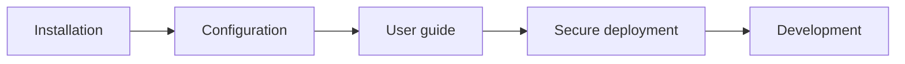

# 📚 AntiFraudBot documentation

[简体中文](../README.md) · [English](README.md) · [Project home](../../README.en.md)

This documentation covers the path from a first local installation to secure deployment and project development. Choose an entry point by goal, then follow the recommended reading order.

## 🧭 Find the right starting point

| I want to… | Start here | Continue with |
|---|---|---|
| Run the bot locally | [Installation](installation.md) | [Configuration](configuration.md) |
| Learn commands, permissions, and interactions | [User guide](user-guide.md) | [Content notice](../../NOTICE.md) |
| Expose the dashboard safely | [Secure deployment](secure-deployment.md) | [Security policy](../../SECURITY.md) |
| Develop plugins, APIs, or frontend features | [Development](development.md) | [Contributing](../../CONTRIBUTING.md) |
| Add or redistribute quizzes and educational content | [Content notice](../../NOTICE.md) | [Contributing](../../CONTRIBUTING.md) |

## 📖 Guide index

| Guide | Audience | Coverage |
|---|---|---|
| [📦 Installation](installation.md) | New operators | Requirements, configuration, database, frontend build, startup, upgrades |
| [🎮 User guide](user-guide.md) | Group admins and users | Commands, permissions, AI, quizzes, dashboard, privacy |
| [🧩 Development](development.md) | Contributors | Architecture, models, APIs, security boundaries, workflow |
| [⚙️ Configuration](configuration.md) | Operators | Complete `.env.prod` reference |
| [🔐 Secure deployment](secure-deployment.md) | Public deployments | HTTPS, proxying, credentials, logs, and data protection |
| [📄 Content notice](../../NOTICE.md) | Content contributors and redistributors | Provenance, licensing, and third-party service boundaries |

## 🛤️ Recommended reading order

> [!TIP]
> For a local evaluation, start with [Installation](installation.md). Before exposing the dashboard publicly, complete the checklist in [Secure deployment](secure-deployment.md).

> [!IMPORTANT]
> Every configuration example uses placeholders. Never commit real QQ IDs, chat records, databases, tokens, API keys, or local `.env` files.

If the documentation does not answer your question, search the project [issues](https://github.com/itsevin/AntiFraudBot/issues) first. Open a new issue with your environment, reproduction steps, and sanitized logs only when no existing issue applies.
