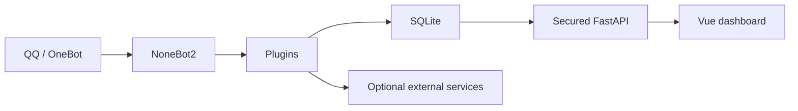

# 🧩 Developer guide

[Documentation](README.md) · [简体中文](../开发者文档.md) · [Contributing](../../CONTRIBUTING.md)

## Stack

| Layer | Technology |
|---|---|
| Bot | NoneBot2, OneBot V11, APScheduler plugin |
| Data | SQLAlchemy 2, nonebot-plugin-orm, SQLite |
| API | FastAPI, OAuth2 Bearer, JWT |
| Frontend | Vue 3, Vite, Pinia, ECharts, Tailwind CSS |
| Tooling | Poetry, pytest, Ruff, GitHub Actions, Dependabot |

## Runtime flow



Plugins live in `src/plugins`; models and CRUD helpers live in `src/database`; dashboard APIs and authentication live in `src/web`.

## Security boundary

`src/web/app.py` applies `get_current_active_user` when registering every business router. The invariant is:

```text
/api/auth/login  anonymous
/api/stats/*     JWT required
/api/visuals/*   JWT required
/api/keywords/*  JWT required
/api/quiz/*      JWT required
```

Do not rely on frontend route guards. New business APIs must be registered inside the protected boundary and covered by unauthorized and authorized regression tests.

`src/web/security.py` owns password policy, constant-time credential comparison, CORS parsing, identifier masking, and login throttling.

## API conventions

- Bound all user-controlled pages, sizes, limits, date ranges, and text lengths.
- Return `401` for missing or invalid authentication.
- Return `503` when administrator credentials are insecurely configured.
- Return `429` after excessive failed logins.
- Do not return complete credentials or user/group identifiers.
- Preserve async I/O in request and event paths.

## Frontend requests

Use `src/web/frontend_v2/src/api/client.js` for authenticated requests. It injects the Bearer token, applies a timeout, and handles `401` by clearing the session. Do not create parallel authentication clients in new components.

## Data and content

Canonical content paths are:

```text
source/quiz_bank.json
source/keyword.txt
source/knowledge/
source/example/
```

Content changes must document source, redistribution permission, and privacy review. See [NOTICE.md](../../NOTICE.md).

## Tests and checks

```bash
poetry run pytest -q
poetry run ruff check src scripts tests
poetry run python scripts/check_open_source.py
poetry check --lock

cd src/web/frontend_v2
npm ci
npm run build
```

Security fixes require both a malicious-condition regression and a legitimate behavior control through the real boundary.
