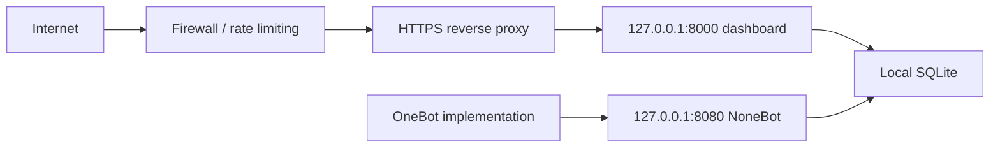

# 🔐 Secure deployment

[Documentation](README.md) · [简体中文](../安全部署.md) · [Security policy](../../SECURITY.md)

## Recommended topology

Keep both application services on loopback. Expose only the HTTPS reverse proxy.

## Minimum controls

- generate a strong dashboard password with a password manager;
- use dedicated least-privilege AI and cloud credentials;
- enforce HTTPS and proxy-level limits on `/api/auth/login`;
- configure exact `WEB_CORS_ORIGINS`, never `*`;
- restrict permissions on `data/`, backups, and logs;
- remove message content and identifiers from exports and screenshots;
- review external provider retention, region, and pricing;
- rotate credentials immediately when disclosure is suspected.

The built-in login throttle is process-local and does not replace reverse-proxy or gateway controls.

## Release checklist

- [ ] Local `.env` files are ignored and untracked.
- [ ] No default or short administrator password is accepted.
- [ ] Application ports are not directly exposed to the Internet.
- [ ] HTTPS and proxy rate limiting are enabled.
- [ ] CORS contains only trusted origins.
- [ ] Cloud credentials use least privilege.
- [ ] Database backups and retention are defined.
- [ ] Logs and screenshots are sanitized.
- [ ] Backend tests, repository checks, and frontend build pass.
- [ ] The operator has read [SECURITY.md](../../SECURITY.md).
