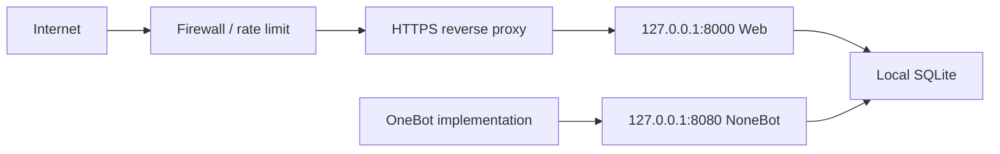

# 🔐 安全部署指南

[文档中心](README.md) · [English](en/secure-deployment.md) · [安全策略](../SECURITY.md)

## 1. 威胁边界

公网部署需要考虑：

- 未授权调用管理 API；
- 默认或弱管理员密码；
- Token、云密钥和数据库泄露；
- 暴力登录与资源消耗；
- CORS 配置错误；
- QQ 号、群号和聊天内容隐私；
- 外部模型与内容安全服务的数据处理；
- 反向代理、主机和 OneBot 实现自身的安全问题。

## 2. 推荐拓扑



Web 和 NoneBot 服务默认保持回环监听。只由反向代理或本机 OneBot 实现访问。

## 3. 凭据

- 后台密码至少 12 位，推荐使用密码管理器生成；
- AI 与阿里云使用独立、最小权限凭据；
- 不在命令行参数、Issue、截图或日志中展示密钥；
- 怀疑泄露时立即轮换，而不是只删除 Git 文件；
- 定期运行 Git 历史密钥扫描。

## 4. HTTPS 与代理

反向代理应：

- 强制 HTTPS；
- 设置合理的请求体、连接和超时限制；
- 对 `/api/auth/login` 增加代理级限流；
- 只转发可信的客户端 IP 头；
- 隐藏服务端版本信息；
- 记录必要但经过脱敏的访问日志。

应用内登录限流只覆盖单进程实例，不能替代反向代理或网关限流。

## 5. CORS

```dotenv
WEB_CORS_ORIGINS=["https://antifraud.example.com"]
```

禁止使用 `*`。来源必须包含协议和实际域名，通常不应包含路径。

## 6. 数据和日志

- 限制 `data/` 目录文件权限；
- 对备份加密并设置保留期限；
- 不把生产数据库复制到公开演示环境；
- 不记录 Authorization 请求头和完整消息正文；
- 导出报表和截图前脱敏用户号、群号和对话内容；
- 根据当地规则提供删除、访问和纠正流程。

## 7. 外部服务

在启用 AI 或 URL 检测前确认：

- 服务商是否保存输入；
- 数据处理地域；
- 是否允许传输个人信息；
- 调用费用和额度；
- 超时和故障时机器人如何降级。

不要把模型输出当作自动处罚或资金决策依据。

## 8. 上线清单

- [ ] `.env` 和 `.env.prod` 未被 Git 跟踪；
- [ ] 后台密码不是默认值且长度足够；
- [ ] Web 和 NoneBot 未直接暴露公网；
- [ ] HTTPS 与代理限流已启用；
- [ ] `WEB_CORS_ORIGINS` 仅包含可信域名；
- [ ] 云端凭据采用最小权限；
- [ ] 数据库已备份且访问受限；
- [ ] 日志和截图流程已脱敏；
- [ ] `poetry run pytest -q` 通过；
- [ ] `poetry run python scripts/check_open_source.py` 通过；
- [ ] 前端生产构建通过；
- [ ] 已阅读 [SECURITY.md](../SECURITY.md)。
