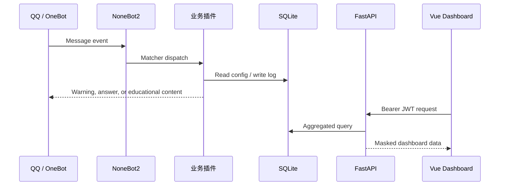

# 🧩 开发者文档

[文档中心](README.md) · [English](en/development.md) · [参与贡献](../CONTRIBUTING.md)

## 1. 技术栈

| 层 | 技术 |
|---|---|
| 机器人运行时 | NoneBot2、OneBot V11、nonebot-plugin-apscheduler |
| 数据层 | SQLAlchemy 2、nonebot-plugin-orm、SQLite |
| Web API | FastAPI、OAuth2 Bearer、JWT |
| 前端 | Vue 3、Vite、Pinia、ECharts、Tailwind CSS |
| 外部调用 | HTTPX、兼容 OpenAI API 的模型服务、阿里云内容安全 |
| 工程化 | Poetry、pytest、Ruff、GitHub Actions、Dependabot |

## 2. 运行时数据流



## 3. 插件结构

`pyproject.toml` 将 `src/plugins` 配置为插件目录。主要插件包括：

| 插件 | 职责 |
|---|---|
| `keyword_detection.py` | 关键词匹配和检测日志 |
| `url_detection/` | URL 提取和可选云端审核 |
| `fraud_ai/` | AI 诈骗话术分析 |
| `ai_chatbot/` | 多轮对话、轻量检索和提示词构建 |
| `quiz/` | 签到、答题和排行榜 |
| `knowledge_push.py` | 定时知识图片推送 |
| `example_push.py` | 定时案例文本推送 |
| `config_manager.py` | 群聊和私聊功能开关 |
| `report_generator.py` | 安全简报生成 |
| `web_loader.py` | 在守护线程中启动 Web 服务 |

### 新插件最小示例

```python
from nonebot import on_command
from nonebot.adapters.onebot.v11 import MessageEvent

status = on_command("系统状态", priority=10, block=True)


@status.handle()
async def handle_status(event: MessageEvent):
    await status.finish("AntiFraudBot 正常运行")
```

插件应避免在导入阶段执行网络请求或破坏性文件操作。

## 4. 数据模型

模型位于 `src/database/models.py`。

| 模型 | 关键用途 |
|---|---|
| `Keyword` | 关键词、分类、风险等级和启用状态 |
| `DetectionLog` | 命中消息、用户、群组、关键词与时间 |
| `UserScore` | 签到、答题和积分统计 |
| `QuizQuestion` | 题目、选项、答案和解析 |
| `GroupConfig` | 群组级功能开关与虚拟坐标 |
| `UserConfig` | 私聊推送偏好 |
| `AIAnalysisLog` | AI 鉴诈输入、输出与模型信息 |
| `ConversationContext` | 多轮对话上下文及过期时间 |
| `ChatbotLog` | 助手响应、耗时和 Token 统计 |
| `DailyBriefing` | 每日安全简报 |

数据访问逻辑集中在 `src/database/crud.py`。新增写操作应尽量复用 CRUD 层，并明确事务提交行为。

## 5. Web 安全边界

`src/web/app.py` 在注册路由时统一为业务 API 添加 `get_current_active_user` 依赖。安全不变量是：

```text
/api/auth/login            → 匿名可访问
/api/stats/*               → JWT 必需
/api/visuals/*             → JWT 必需
/api/keywords/*            → JWT 必需
/api/quiz/*                → JWT 必需
```

不要只在单个接口或前端路由守卫中添加鉴权。新增业务路由应注册到受保护边界内，并增加未授权 `401` 和授权成功的回归测试。

安全工具位于 `src/web/security.py`：

- 管理员密码策略；
- 常量时间凭据比较；
- CORS 来源解析；
- 用户/群组标识脱敏；
- 登录失败限流。

## 6. API 约定

- 分页从 `page=1` 开始；
- `size`、`limit`、`days` 必须有明确上限；
- 无效输入由 FastAPI/Pydantic 返回 `422`；
- 无效或缺失 Token 返回 `401`；
- 登录配置不安全返回 `503`；
- 登录尝试过多返回 `429`；
- 响应不得包含完整 Token、密码、用户号或群号。

FastAPI 自动文档在服务启动后可通过 `/docs` 查看，但生产环境应通过网络边界限制访问。

## 7. 前端数据访问

前端统一使用 `src/web/frontend_v2/src/api/client.js`：

- 自动从 `localStorage` 注入 Bearer Token；
- 设置请求超时；
- 收到 `401` 时清理 Token 并返回登录页。

不要在新组件中直接创建另一个 Axios 鉴权实现。登录请求可以使用匿名 Axios 请求。

## 8. 内容与题库

规范路径：

```text
source/quiz_bank.json
source/keyword.txt
source/knowledge/
source/example/
```

题库是 JSON 数组，每项至少包含：

```json
{
  "category": "冒充客服",
  "question": "示例问题",
  "options": ["A. 选项一", "B. 选项二"],
  "answer": "A",
  "explanation": "答案说明",
  "difficulty": 1
}
```

内容贡献必须满足 [NOTICE.md](../NOTICE.md) 和 [CONTRIBUTING.md](../CONTRIBUTING.md) 的来源、许可与隐私要求。

## 9. 初始化与迁移

`scripts/init_database.py` 负责：

- 创建当前模型表；
- 修补已知旧字段；
- 迁移旧 `data/data.json` 中可映射配置；
- 清理重复积分记录；
- 导入题库和关键词；
- 创建本地配置模板。

新增数据结构时，优先引入正式、可回滚的版本化迁移，不要继续扩展无版本的手写 SQL 修补。

## 10. 测试策略

现有测试覆盖：

- 密码策略与常量时间比较；
- CORS 解析与通配符拒绝；
- 标识脱敏；
- 登录限流；
- 所有业务 API 未登录时返回 `401`；
- 合法登录和受保护接口访问；
- 弱密码 fail-closed；
- 题库路径和旧配置迁移规则。

运行：

```bash
poetry run pytest -q
poetry run ruff check src scripts tests
```

安全修复必须同时包含恶意条件和合法条件测试。

## 11. 提交前检查

```bash
poetry check --lock
poetry run python -m pip check
poetry run pytest -q
poetry run ruff check src scripts tests
poetry run python scripts/check_open_source.py

cd src/web/frontend_v2
npm ci
npm run build
```

最后检查：

```bash
git diff --check
git status --short
```

不得提交 `.env`、`.env.prod`、数据库、JWT 密钥、构建产物或真实用户数据。
